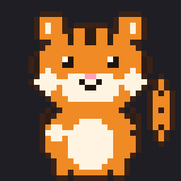
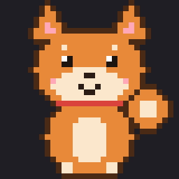
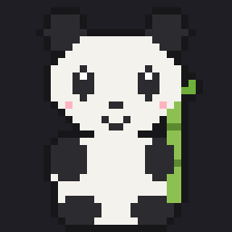
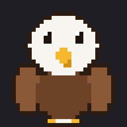

<div align="center">

 <br>
   

# dotchi（どっち）

**どんな絵でもピクセルアートのペットにふ化させて、Claude Code のそばに置いておけます。**

[English](README.md) · [한국어](README.ko.md) · **日本語** · [中文](README.zh.md)

</div>

---

dotchi は [Claude Code](https://docs.claude.com/en/docs/claude-code) 用の mod です。ペットはターミナルの会話のとなりに住んでいます。Claude が作業しているあいだ動き、マンガの吹き出しでしゃべり、スピナーの言葉を自分のセリフに変え、返答のあとに一言を添えることもできます。

<p align="center">
  
</p>

## 特長

- 🥚 **自分のペットをふ化。** どんな絵でも、画像処理で 32×32 のピクセルアートにします。そのあと Claude が手直しし、名前・性格・動かす部分を聞いて、その部分を動かし、セリフを書きます。承認するまで何も保存しません。
- 🎞️ **本物のピクセルアニメーション。** 絵全体をずらすのではなく、腕・脚・耳・しっぽ・車輪など選んだ部分が動きます。
- 💬 **おしゃべりします。** マンガの吹き出し、Claude の作業中に出るスピナーのセリフ、返答のあとの一言（任意）。
- 🪟 **入力欄の上か、サイドパネル。** ペットを右側のパネルに置き、返答は残りの画面を使えます。
- 📦 **パックを共有。** キャラクター 1 体が小さなパック 1 つ。コマンド 1 つで [dotchi ペットサイト](https://ms1011.github.io/dotchi-packs) に公開するか、zip に書き出せます。
- 🌏 **セリフは 4 言語。** ペットは韓国語・英語・日本語・中国語（簡体字）で話します。コマンドの案内は英語です。
- 🐿️🐢 **最初から 6 体:** どんぐりを抱えたリス、実はとても速いカメ、そして国ごとに 1 体ずつトラ 🐯（韓国）、柴犬 🐕（日本）、パンダ 🐼（中国）、ハクトウワシ 🦅（アメリカ）

<p align="center">
  
</p>

## インストール

Claude Code で:

```
/plugin install dotchi --marketplace ms1011/dotchi
```

マーケットプレイスを追加するか聞かれたら `y`、スコープはユーザー（user）を選びます。シェルからは:

```sh
claude plugin install dotchi --marketplace ms1011/dotchi
```

**必要なもの**

- mod に対応した Claude Code（v2.1.306 以降）
- ふ化と zip パックには Python 3。初めてふ化するときに OpenCV・numpy・Pillow を `~/.claude/dotchi/venv` にインストールします。
- サイトにペットを公開するには、ログイン済みの [GitHub CLI](https://cli.github.com)（`gh`）

**アップデート**

```sh
claude plugin marketplace update dotchi
claude plugin update dotchi
```

そのあと Claude Code を再起動します。自分のキャラクターは `~/.claude/dotchi` にあるので、アップデートしても消えません。

## コマンド

すべて `/dotchi` の下にあります。

| コマンド | 内容 |
| :- | :- |
| `/dotchi` | 現在の設定を表示 |
| `/dotchi <キャラクター>` | キャラクターを切り替え（id または名前） |
| `/dotchi list` | 標準とマイキャラの一覧 |
| `/dotchi hatch [画像のパス]` | 絵から新しいキャラクターをふ化 |
| `/dotchi edit <キャラクター>` | Claude と一緒に手直し |
| `/dotchi install <zip、フォルダー、またはサイトの id>` | パック、またはサイトのペットを id かリンクでインストール |
| `/dotchi export <キャラクター> [--with-source]` | 今のフォルダーに `<id>.dotchi.zip` として保存 |
| `/dotchi share <キャラクター> [--as <id>]` | dotchi サイトにペットを公開（id が使われていたら `--as` で先に変更） |
| `/dotchi unshare <キャラクター>` | サイトから自分のペットを取り下げ |
| `/dotchi remove <キャラクター>` | マイキャラを削除 |
| `/dotchi show always\|working\|side` | 常に / Claude の作業中のみ / サイドパネル |
| `/dotchi voice on\|off` | 返答のあとの一言 |
| `/dotchi lang ko\|en\|ja\|zh\|auto` | ペットのセリフと名前の言語（`auto` はシステム設定に従います） |

**サイドパネル。** `/dotchi show side` でペットが右側のパネル（幅の約 20%）に移ります。フルスクリーンモードで会話の横に並ぶので、一度 `/tui fullscreen` を実行してください。幅は `Ctrl+X` のあと矢印キーで変え、`Ctrl+X` のあと `X` で閉じます。

## 自分のペットをふ化させる

```
/dotchi hatch ~/Pictures/my-cat.png
```

<p align="center">
  
</p>

Claude が一度にひとつずつ質問しながら進めます。

1. 絵をピクセルアートにして、つぶれた部分（目・口・輪郭）を直します。
2. 名前と性格を聞きます。
3. 動かせそうな部分（腕・脚・耳・しっぽ、車なら車輪や煙）を提案し、選んでもらいます。
4. 選んだ部分だけを 3〜5 コマで動かします。
5. 性格に合ったセリフを書きます。
6. プレビュー画像と動く GIF を見せ、パックを検査し、承認されたら保存します。

あとで直すには `/dotchi edit <キャラクター>`。

## パックを共有する

**dotchi ペットサイトで。** [ms1011.github.io/dotchi-packs](https://ms1011.github.io/dotchi-packs) にみんなが作ったペットが集まっています。ペットごとにインストールコマンドをコピーするボタンがあります。

```
/dotchi share my-cat               # gh で ms1011/dotchi-packs に Issue を作成
/dotchi install my-cat             # だれでも id（またはペットのページのリンク）でインストール
/dotchi unshare my-cat             # 取り下げ
```

公開には GitHub にログインした `gh` が必要です。Issue でチェックが走り、通れば 1〜2 分でサイトに表示されます。いいねは GitHub 上のそのペットの Issue に付ける 👍 なので GitHub アカウントが必要で、サイトの数は 1 分ほどで反映されます。

**ファイルで。**

```
/dotchi export my-cat              # → ./my-cat.dotchi.zip
/dotchi install ~/Downloads/my-cat.dotchi.zip
```

パックはフォルダー 1 つ（またはその zip）です。

```
<パック>/
  dotchi.json   { "format": 1, "id", "name", "author"?, "description"?, "frameMs"? }
  art.json      { "width": 32, "height": 32, "idle": Frame, "work": [Frame, …] }   （1〜5 コマ）
  lines.json    { "<言語>": { "spinner": [...], "idle": [...], "ending": [...] }, … }
  grid/         （任意）編集できるテキストのグリッド
  source/       （任意）元の絵
```

- `id`: 小文字・数字・`-` で 32 文字まで。すでにある場合はインストール時に `-2`、`-3` … を付けます。
- `name`: 文字列 1 つ、または言語ごとの名前: `{ "ja": "リス", "en": "Squirrel" }`
- `frameMs`: 1 コマの長さ、60〜1000ms（標準 250）
- `lines.json`: `ko`・`en`・`ja`・`zh` のどれでも。ない言語は英語、次にパックの最初の言語で表示します。
- `Frame` は 32 行 × 32 マスで、1 マスは `"rrggbb"` または透明（`null`）です。
- インストールと書き出しでは上のファイルだけをコピーし、シンボリックリンクは飛ばします。`--with-source` を付けない限り `source/` は書き出しません。

> [!NOTE]
> **作者を尊重してください。** 他の人の絵からキャラクターをふ化させた場合は、個人で使うだけにして、パックを公開しないでください。

## ファイルの場所

| パス | 内容 |
| :- | :- |
| `~/.claude/dotchi/characters/` | ふ化・インストールしたキャラクター |
| `~/.claude/dotchi/drafts/` | ふ化・手直し中のキャラクター |
| `~/.claude/dotchi/venv/` | 画像処理ツール |

## dotchi が送るもの・受け取るもの

dotchi には分析や利用状況の送信はありません。ペットの表示、切り替え、編集、書き出し、zip やフォルダーからのインストールはすべて手元のコンピューターの中で完結します。ネットワークを使うのは次のコマンドだけです。

| いつ | 何をするか |
| :- | :- |
| 初めての `/dotchi hatch` | `tools/setup.sh` が `~/.claude/dotchi/venv` を作り、PyPI から numpy・opencv-python-headless・pillow をインストールします。バージョンは `tools/requirements.lock` で固定しています。絵の処理は手元で行います。絵とプレビューは、会話で見せるほかのファイルと同じように Claude が読みます。 |
| `/dotchi install <id またはリンク>` | そのペットの `dotchi.json`・`art.json`・`lines.json` を `https://ms1011.github.io/dotchi-packs/packs/<id>/` からダウンロードします。このダウンロードのリクエスト以外に、あなたやあなたのペットについての情報は送りません。 |
| `/dotchi share <キャラクター>` | id が使われていないか確かめるために `https://ms1011.github.io/dotchi-packs/index.json` を読み、GitHub のユーザー id を知るために `gh auth status` と `gh api user` を実行します。そのあと `gh issue create` で [ms1011/dotchi-packs](https://github.com/ms1011/dotchi-packs) にあなたの GitHub アカウントで**公開**の Issue を作ります。Issue にはペットの名前と紹介、パック（`dotchi.json`・`art.json`・`lines.json`・`grid/*.txt` を gzip にまとめたもの）が入ります。元の絵（`source/`）は送りません。公開されると、サイトにペットとあなたの GitHub ユーザー名が表示されます。 |
| `/dotchi unshare <キャラクター>` | `gh auth status` を実行してから、ms1011/dotchi-packs にそのペットの取り下げを頼む公開 Issue を作ります。 |

dotchi が GitHub のトークンを直接読むことはありません。`gh` が `gh auth login` で設定したログインを使います。公開したペットは誰でも見られます。自分で描いた絵や撮った写真など、共有する権利のある絵から作ったペットだけを公開してください。

[dotchi ペットサイト](https://ms1011.github.io/dotchi-packs)はブラウザーで動きます。ペットは GitHub Pages から読み込み、ペットごとの 👍 の数を `api.github.com` に問い合わせます。

## 開発

```sh
claude --plugin-dir .                     # このフォルダーを mod として Claude Code を起動
claude plugin validate .
claude plugin test .
sh tools/setup.sh                         # ~/.claude/dotchi/venv を作成
~/.claude/dotchi/venv/bin/python -m unittest discover -s tools -p "test_*.py"
~/.claude/dotchi/venv/bin/python tools/defaults/build.py   # 標準キャラクターを作り直す
```

`tsconfig.json` は `.claude-plugin/types/` を継承します。このフォルダーは、Claude Code がこのフォルダーの mod を初めて読み込むとき（`claude --plugin-dir .`）に作られます。その後は `tsc -p .` で型チェックできます。

## ライセンス

[MIT](LICENSE)
