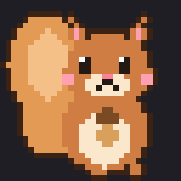
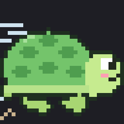
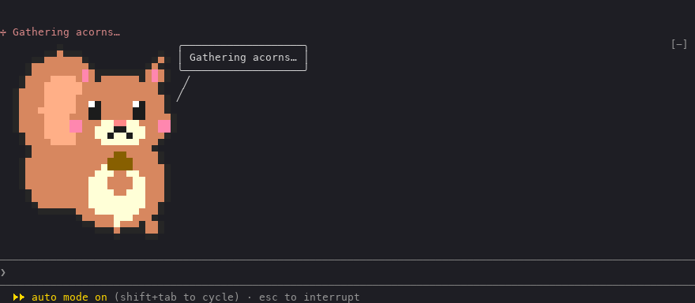
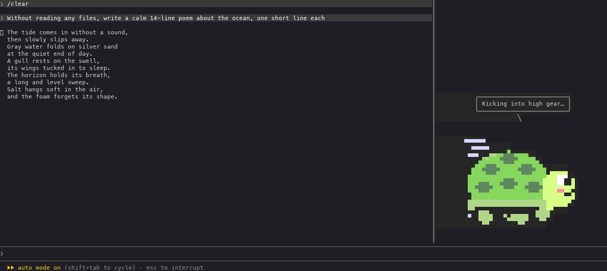
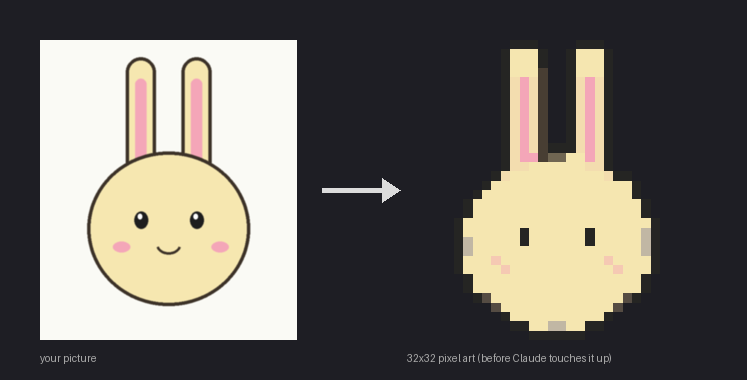

<div align="center">

 

# 도찌 (dotchi)

**어떤 그림이든 픽셀 아트 펫으로 부화시켜 Claude Code 옆에 두세요.**

[English](README.md) · **한국어** · [日本語](README.ja.md) · [中文](README.zh.md)

</div>

---

도찌는 [Claude Code](https://docs.claude.com/en/docs/claude-code)용 mod예요. 펫이 터미널에서 대화 옆에 살아요. Claude가 일하는 동안 움직이고, 만화 말풍선으로 말하고, 스피너 문구를 자기 말투로 바꾸고, 답변이 끝날 때 한마디를 붙일 수도 있어요.

<p align="center">
  
</p>

## 기능

- 🥚 **내 펫 부화시키기.** 아무 그림이나 주면 영상처리로 32×32 픽셀 아트를 만들어요. 그다음 Claude가 다듬고, 이름과 성격과 움직일 곳을 묻고, 고른 곳을 움직이게 만들고, 대사를 써요. 승인하기 전에는 아무것도 저장하지 않아요.
- 🎞️ **진짜 픽셀 애니메이션.** 그림을 통째로 옮기는 게 아니라 팔, 다리, 귀, 꼬리, 바퀴처럼 고른 부분이 움직여요.
- 💬 **말을 해요.** 만화 말풍선, Claude가 일하는 동안 나오는 스피너 문구, 답변 끝 한마디(선택)가 있어요.
- 🪟 **입력창 위 또는 옆 패널.** 펫을 오른쪽 패널에 두고 답변은 나머지 화면을 쓰게 할 수 있어요.
- 📦 **팩 공유.** 캐릭터 하나가 작은 팩 하나예요. 명령 하나로 [도찌 펫 사이트](https://ms1011.github.io/dotchi-packs)에 올리거나 zip으로 내보낼 수 있어요.
- 🌏 **대사 4개 언어.** 펫이 한국어, 영어, 일본어, 중국어(간체)로 말해요. 명령 안내 문구는 영어예요.
- 🐿️🐢 **처음부터 두 마리:** 도토리를 안은 다람쥐, 알고 보니 엄청 빠른 거북이

<p align="center">
  
</p>

## 설치

Claude Code에서:

```
/plugin install dotchi --marketplace ms1011/dotchi
```

마켓플레이스를 추가할지 물으면 `y`, 범위는 사용자(user)를 고르세요. 셸에서는:

```sh
claude plugin install dotchi --marketplace ms1011/dotchi
```

**필요한 것**

- mod를 지원하는 Claude Code (v2.1.306 이상)
- 부화와 zip 팩에는 Python 3. 처음 부화할 때 OpenCV, numpy, Pillow를 `~/.claude/dotchi/venv`에 설치해요.
- 사이트에 펫을 올리려면 로그인한 [GitHub CLI](https://cli.github.com)(`gh`)

**업데이트**

```sh
claude plugin marketplace update dotchi
claude plugin update dotchi
```

그다음 Claude Code를 다시 시작하세요. 내 캐릭터는 `~/.claude/dotchi`에 있어서 업데이트해도 사라지지 않아요.

## 명령

모두 `/dotchi` 아래에 있어요.

| 명령 | 하는 일 |
| :- | :- |
| `/dotchi` | 지금 설정 보기 |
| `/dotchi <캐릭터>` | 캐릭터 바꾸기 (id나 이름) |
| `/dotchi list` | 기본 캐릭터와 내 캐릭터 목록 |
| `/dotchi hatch [그림 경로]` | 그림으로 새 캐릭터 부화 |
| `/dotchi edit <캐릭터>` | Claude와 캐릭터 다듬기 |
| `/dotchi install <zip, 폴더 또는 사이트 id>` | 팩 설치, 또는 사이트의 펫을 id나 링크로 설치 |
| `/dotchi export <캐릭터> [--with-source]` | 지금 폴더에 `<id>.dotchi.zip`으로 저장 |
| `/dotchi share <캐릭터> [--as <id>]` | 도찌 사이트에 펫 올리기 (id가 이미 쓰이면 `--as`로 먼저 바꾸기) |
| `/dotchi unshare <캐릭터>` | 사이트에서 내 펫 내리기 |
| `/dotchi remove <캐릭터>` | 내 캐릭터 지우기 |
| `/dotchi show always\|working\|side` | 항상 / Claude가 일할 때만 / 옆 패널 |
| `/dotchi voice on\|off` | 답변 끝 한마디 |
| `/dotchi lang ko\|en\|ja\|zh\|auto` | 펫의 대사와 이름 언어 (`auto`는 컴퓨터 설정을 따라요) |

**옆 패널.** `/dotchi show side`를 실행하면 펫이 오른쪽 패널(너비의 약 20%)로 가요. 전체 화면 모드에서 대화 옆에 붙으니 `/tui fullscreen`을 한 번 실행하세요. 너비는 `Ctrl+X` 다음 화살표 키로 바꾸고, `Ctrl+X` 다음 `X`로 닫아요.

## 내 펫 부화시키기

```
/dotchi hatch ~/Pictures/my-cat.png
```

<p align="center">
  
</p>

Claude가 한 번에 하나씩 물어보면서 진행해요.

1. 그림을 픽셀 아트로 바꾸고 뭉개진 곳(눈, 입, 외곽선)을 고쳐요.
2. 이름과 성격을 물어요.
3. 움직일 수 있는 곳(팔, 다리, 귀, 꼬리, 자동차라면 바퀴와 연기)을 제안하고 고르게 해요.
4. 고른 곳만 3~5컷으로 움직이게 만들어요.
5. 성격에 맞는 대사를 써요.
6. 미리보기 그림과 움직이는 GIF를 보여 주고, 팩을 검사한 뒤, 승인하면 저장해요.

나중에 고치려면 `/dotchi edit <캐릭터>`.

## 팩 공유

**도찌 펫 사이트에서.** [ms1011.github.io/dotchi-packs](https://ms1011.github.io/dotchi-packs)에 사람들이 만든 펫이 모여 있어요. 펫마다 설치 명령을 복사하는 버튼이 있어요.

```
/dotchi share my-cat               # gh로 ms1011/dotchi-packs에 Issue를 열어요
/dotchi install my-cat             # 누구나 id(또는 펫 페이지 주소)로 설치해요
/dotchi unshare my-cat             # 내리기
```

올리려면 GitHub에 로그인한 `gh`가 필요해요. Issue에서 검사가 돌고, 통과하면 1~2분 안에 사이트에 나와요. 좋아요는 GitHub에 있는 그 펫의 Issue에 누르는 👍라서 GitHub 계정이 있어야 하고, 사이트에는 1분쯤 안에 반영돼요.

**파일로.**

```
/dotchi export my-cat              # → ./my-cat.dotchi.zip
/dotchi install ~/Downloads/my-cat.dotchi.zip
```

팩은 폴더 하나(또는 그 폴더의 zip)예요.

```
<팩>/
  dotchi.json   { "format": 1, "id", "name", "author"?, "description"?, "frameMs"? }
  art.json      { "width": 32, "height": 32, "idle": Frame, "work": [Frame, …] }   (컷 1~5장)
  lines.json    { "<언어>": { "spinner": [...], "idle": [...], "ending": [...] }, … }
  grid/         (선택) 고칠 수 있는 격자 텍스트
  source/       (선택) 원본 그림
```

- `id`: 소문자, 숫자, `-`로 32자까지. 이미 있으면 설치할 때 `-2`, `-3`…을 붙여요.
- `name`: 문자열 하나, 또는 언어별 이름: `{ "ko": "다람쥐", "en": "Squirrel" }`
- `frameMs`: 한 컷의 길이, 60~1000ms (기본 250)
- `lines.json`: `ko`, `en`, `ja`, `zh` 중 아무거나. 없는 언어는 영어, 그다음 팩의 첫 언어로 보여요.
- `Frame`은 32줄 × 32칸이고, 한 칸은 `"rrggbb"` 또는 투명(`null`)이에요.
- 설치하고 내보낼 때는 위 파일만 복사하고, 심볼릭 링크는 건너뛰어요. `--with-source`를 붙이지 않으면 `source/`는 내보내지 않아요.

> [!NOTE]
> **작가를 존중해 주세요.** 다른 사람의 그림으로 캐릭터를 부화시켰다면 개인용으로만 쓰고 팩을 공개적으로 공유하지 마세요.

## 파일 위치

| 경로 | 내용 |
| :- | :- |
| `~/.claude/dotchi/characters/` | 부화시키거나 설치한 캐릭터 |
| `~/.claude/dotchi/drafts/` | 부화·다듬기 중인 캐릭터 |
| `~/.claude/dotchi/venv/` | 영상처리 도구 |

## 도찌가 보내고 받는 것

도찌에는 분석이나 사용 기록 전송이 없어요. 펫 보여 주기, 바꾸기, 다듬기, 내보내기, zip·폴더로 설치하기는 모두 내 컴퓨터 안에서만 일어나요. 네트워크를 쓰는 건 아래 명령뿐이에요.

| 언제 | 하는 일 |
| :- | :- |
| 처음 `/dotchi hatch` | `tools/setup.sh`가 `~/.claude/dotchi/venv`를 만들고 PyPI에서 numpy, opencv-python-headless, pillow를 설치해요. 버전은 `tools/requirements.lock`에 고정돼 있어요. 그림 처리는 내 컴퓨터에서 해요. 그림과 미리보기는 대화에 보여 주는 다른 파일처럼 Claude가 읽어요. |
| `/dotchi install <id 또는 링크>` | 그 펫의 `dotchi.json`, `art.json`, `lines.json`을 `https://ms1011.github.io/dotchi-packs/packs/<id>/`에서 받아요. 이 다운로드 요청 말고는 나나 내 펫에 대한 어떤 정보도 보내지 않아요. |
| `/dotchi share <캐릭터>` | id가 이미 쓰이는지 보려고 `https://ms1011.github.io/dotchi-packs/index.json`을 읽고, 내 GitHub 사용자 id를 알려고 `gh auth status`와 `gh api user`를 실행해요. 그다음 `gh issue create`로 [ms1011/dotchi-packs](https://github.com/ms1011/dotchi-packs)에 내 GitHub 계정으로 **공개** Issue를 열어요. Issue에는 펫 이름과 소개, 팩(`dotchi.json`, `art.json`, `lines.json`, `grid/*.txt`를 gzip으로 묶은 것)이 들어가요. 원본 그림(`source/`)은 보내지 않아요. 게시되면 사이트에 펫과 내 GitHub 아이디가 보여요. |
| `/dotchi unshare <캐릭터>` | `gh auth status`를 실행한 뒤 ms1011/dotchi-packs에 그 펫을 내려 달라는 공개 Issue를 열어요. |

도찌는 GitHub 토큰을 직접 읽지 않아요. `gh`가 `gh auth login`으로 해 둔 로그인을 써요. 올린 펫은 공개돼요. 직접 그렸거나 찍었거나, 공유할 권리가 있는 그림으로 만든 펫만 올려 주세요.

[도찌 펫 사이트](https://ms1011.github.io/dotchi-packs)는 브라우저에서 돌아가요. 펫은 GitHub Pages에서 받고, 펫마다 👍 수를 `api.github.com`에 물어요.

## 개발

```sh
claude --plugin-dir .                     # 이 폴더를 mod로 켜고 Claude Code 실행
claude plugin validate .
claude plugin test .
sh tools/setup.sh                         # ~/.claude/dotchi/venv 만들기
~/.claude/dotchi/venv/bin/python -m unittest discover -s tools -p "test_*.py"
~/.claude/dotchi/venv/bin/python tools/defaults/build.py   # 기본 캐릭터 다시 만들기
```

`tsconfig.json`은 `.claude-plugin/types/`를 이어받아요. 이 폴더는 Claude Code가 이 폴더의 mod를 처음 불러올 때(`claude --plugin-dir .`) 만들어요. 그 뒤로는 `tsc -p .`로 타입 검사를 할 수 있어요.

## 라이선스

[MIT](LICENSE)
