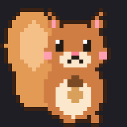
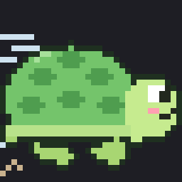
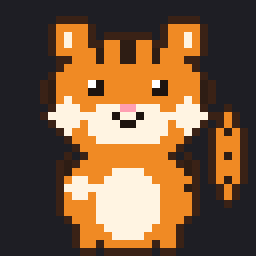
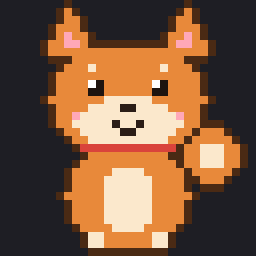
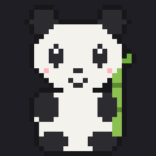
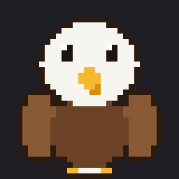
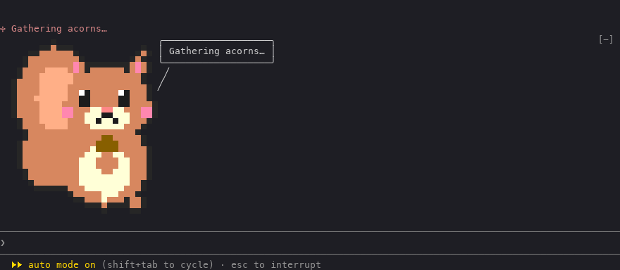
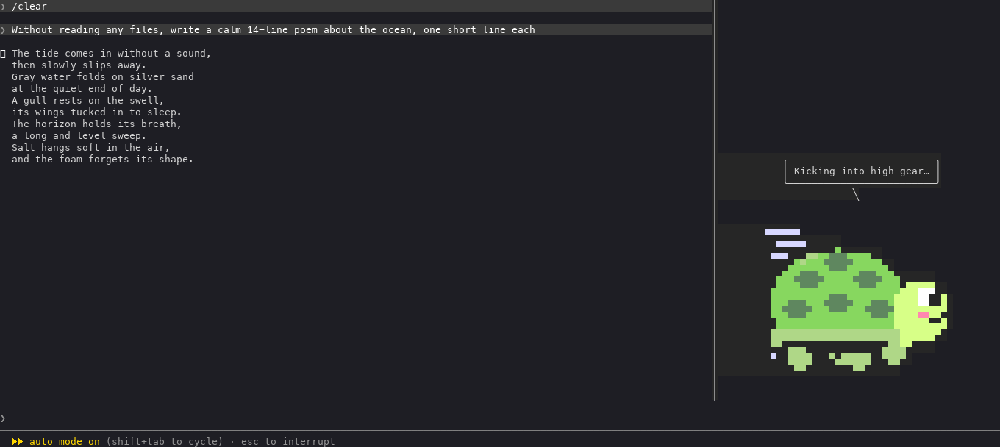
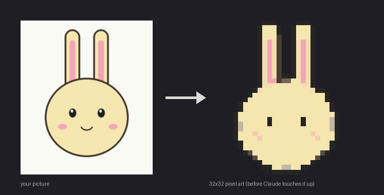

<div align="center">

 <br>
   

# dotchi

**Hatch a pixel-art pet from any picture and keep it beside you in Claude Code.**

**English** · [한국어](README.ko.md) · [日本語](README.ja.md) · [中文](README.zh.md)

</div>

---

dotchi is a mod for [Claude Code](https://docs.claude.com/en/docs/claude-code). Your pet lives in the terminal next to your conversation. It moves while Claude works, talks in a comic speech bubble, swaps the spinner word for its own lines, and can add a one-liner after each answer.

<p align="center">
  
</p>

## Features

- 🥚 **Hatch your own pet.** Give it any picture. Image processing turns it into 32×32 pixel art, then Claude touches it up, asks for a name, a personality and which parts should move, animates those parts and writes its lines. Nothing is saved until you approve.
- 🎞️ **Real pixel animation.** Arms, legs, ears, tails, wheels: the parts you choose move, not just the whole picture.
- 💬 **It talks.** A comic speech bubble, its own spinner lines while Claude works, and an optional one-liner after each answer.
- 🪟 **Above the prompt or in a side panel.** Keep your pet in a panel on the right while answers use the rest of the screen.
- 👀 **It watches for you.** Warns at 80, 85, 90, 95 and 99% of your weekly limit, sends a desktop notification when a long answer is done, and tells you before you pick up a big chat that has been idle for a day. The side panel also keeps `git status` and the artifacts of this session in view.
- 📊 **A tamagotchi gauge.** The status line shows how full the context is as hearts `♥♥♥♡♡ 62%`, the weekly limit as `⚡ 41%`, the branch with its uncommitted `+/−` lines, and how long the session has run. The pet looks worried from 70% and asks for `/compact` at 90%. The side panel shows the same in pastel colors.
- 🎨 **Status-line themes.** Pick how the gauges look, separately from your pet: pastel (default), candy, forest or plain-ASCII mono. Make your own with Claude, tweak one color or emoji with a command, and share it on the [dotchi site](https://ms1011.github.io/dotchi-packs/?tab=themes).
- 📦 **Share packs.** Every character is a small pack. Share it on [the dotchi pets site](https://ms1011.github.io/dotchi-packs) with one command, or export it as a zip.
- 🌏 **Lines in four languages.** Your pet can talk in Korean, English, Japanese or Simplified Chinese. Command messages are in English.
- 🐿️🐢 **Six pets to start with:** a squirrel hugging an acorn, a turtle that turns out to be very fast, and one from each of our languages: a tiger 🐯 (Korea), a Shiba Inu 🐕 (Japan), a panda 🐼 (China) and a bald eagle 🦅 (USA).

<p align="center">
  
</p>

## Install

In Claude Code:

```
/plugin install dotchi --marketplace ms1011/dotchi
```

Answer `y` to add the marketplace and pick the user scope. Or from a shell:

```sh
claude plugin install dotchi --marketplace ms1011/dotchi
```

**Requirements**

- Claude Code with mods (v2.1.306 or later)
- Python 3 for hatching and for zip packs. The first hatch installs OpenCV, numpy and Pillow into `~/.claude/dotchi/venv`.
- The [GitHub CLI](https://cli.github.com) (`gh`, logged in) to share pets on the site

**Update**

```sh
claude plugin marketplace update dotchi
claude plugin update dotchi
```

Then restart Claude Code. Your own characters live in `~/.claude/dotchi` and survive updates.

## Commands

Everything is under `/dotchi`.

| Command | What it does |
| :- | :- |
| `/dotchi` | Show the current settings |
| `/dotchi <character>` | Switch character (id or any of its names) |
| `/dotchi list` | List built-in characters and yours |
| `/dotchi hatch [image path]` | Hatch a new character from a picture |
| `/dotchi edit <character>` | Touch up a character with Claude |
| `/dotchi install <zip, folder or site id>` | Install a pack, or a pet from the site by id or link |
| `/dotchi export <character> [--with-source]` | Save a pack as `<id>.dotchi.zip` in the current folder |
| `/dotchi share <character> [--as <id>]` | Share a pet on the dotchi site (`--as` renames it first if the id is taken) |
| `/dotchi unshare <character>` | Take your pet down from the site |
| `/dotchi remove <character>` | Remove one of your characters |
| `/dotchi show always\|working\|side` | Show always, only while Claude works, or in a side panel |
| `/dotchi voice on\|off` | One-liner after each answer |
| `/dotchi limit on\|off` | Weekly-limit warnings at 80, 85, 90, 95 and 99% |
| `/dotchi notify on\|off` | Desktop notification when an answer took a while |
| `/dotchi notify after <seconds>` | How long counts as a while (default 60) |
| `/dotchi notify fix` | Switch Claude Code's notification channel to `iterm2_with_bell`, if notifications don't reach you |
| `/dotchi rest <hours> <tokens>\|off` | Warn when you start typing into a chat of at least that many tokens after that many hours away (default 24 h, 100k) |
| `/dotchi line full\|mini\|off` | What the status line shows: everything (default), only the percentages and branch, or nothing |
| `/dotchi line cost on\|off` | Add the session cost ($) to the status line and panel (off by default: on a subscription it is not what you pay) |
| `/dotchi line context\|week <warn> <danger>\|reset` | Change where the gauges turn yellow and coral, in % (default context 70/90, week 80/95). The context one also sets when the pet asks for `/compact` |
| `/dotchi theme [list]` | Status-line themes, built-in and yours |
| `/dotchi theme <theme>` | Switch theme (id or name) |
| `/dotchi theme new [idea]` | Make a theme with Claude: it asks for a mood, writes `theme.json`, checks it and shows a preview |
| `/dotchi theme edit [theme]` | Touch up a theme with Claude (the current one if you leave it out) |
| `/dotchi theme set <key> <value>` | Change one part of the current theme: `color.ok #8fd9b6`, `face.danger (×_×)`, `hearts ♥ ♡`, `bar ▰ ▱`, `symbol.week ⚡` … |
| `/dotchi theme install <file or site id>` | Install a `theme.json`, or a theme from the site by id or link |
| `/dotchi theme export <theme>` | Save it as `<id>.theme.json` in this folder |
| `/dotchi theme share <theme> [--as <id>]` | Share a theme on the dotchi site |
| `/dotchi theme unshare <theme>` | Take your theme down from the site |
| `/dotchi theme remove <theme>` | Remove a theme of yours |
| `/dotchi lang ko\|en\|ja\|zh\|auto` | Language of the pet's lines and names (`auto` follows your system) |

**Notifications.** Claude Code sends its own notification when it waits for your approval; the pet only says so in its bubble. The notification for a long answer comes from dotchi. They travel as terminal notifications, so your terminal app has to show them. If it doesn't, run `/dotchi notify fix`.

**Git and artifacts.** In the side panel the pet stands above the branch, the changed files (✎ marks the ones Claude edited) and the artifacts Claude published in this session. Without the panel, the status line shows a one-line summary.

**Status line.** `🌰 ♥♥♥♡♡ 62% · ⚡ 41% · ⎇ main ↑2 · 3 files +120 −8 · 12m · 🔗 Report`. The hearts are how full the context is: from 70% the pet frowns `(•_•;)`, and at 90% it goes `(×_×)` and asks once for `/compact`. `⚡` is the weekly limit, and 🥱 means it runs out before the reset at this pace. Anything zero or unknown is left out. All these percentages can be changed with `/dotchi line context` and `/dotchi line week`. In the side panel the same numbers become pastel bars, the face takes your pet's own color, and the last line shows the session time, model and context size.

**Themes.** A theme is only the look: five colors (`ok`, `warn`, `danger`, `dim`, `accent`, where an accent of `pet` means your pet's own color), three faces, the heart and bar glyphs, and four symbols. Your percentages stay yours. Themes live in `~/.claude/dotchi/themes/<id>/theme.json`; any part you leave out falls back to pastel. Changing a built-in theme makes your own copy with the same id, and removing that copy brings the built-in back. Check a file with `python3 tools/theme.py check <file>` and see it in color with `python3 tools/theme.py preview <file>`.

**Side panel.** `/dotchi show side` puts your pet in a panel on the right, about 20% of the width. It docks beside the conversation in fullscreen mode, so run `/tui fullscreen` once. Resize it with `Ctrl+X` then the arrow keys, and close it with `Ctrl+X` then `X`.

## Hatch your own

```
/dotchi hatch ~/Pictures/my-cat.png
```

<p align="center">
  
</p>

Claude walks you through it, one question at a time:

1. Turns the picture into pixel art and fixes what got mushed (eyes, mouth, outline).
2. Asks for a name and a personality.
3. Suggests what could move (arms, legs, ears, tail, or wheels and smoke for a car) and lets you choose.
4. Animates only those parts, in 3 to 5 frames.
5. Writes lines that fit the personality.
6. Shows you a preview image and an animated GIF, checks the pack, and saves it only when you approve.

Change it later with `/dotchi edit <character>`.

## Share packs

**On the dotchi pets site.** [ms1011.github.io/dotchi-packs](https://ms1011.github.io/dotchi-packs) lists pets people made. Each page has a copy button for its install command.

```
/dotchi share my-cat               # opens an issue on ms1011/dotchi-packs with gh
/dotchi install my-cat             # anyone can install it by id (or by its page link)
/dotchi unshare my-cat             # take it down
```

Sharing needs `gh` logged in to GitHub. A check runs on the issue and the pet shows up on the site within a minute or two if it passes. Likes are 👍 reactions on the pet's issue on GitHub, so you need a GitHub account to like one; the site shows the new count within a minute or so.

**As a file.**

```
/dotchi export my-cat              # → ./my-cat.dotchi.zip
/dotchi install ~/Downloads/my-cat.dotchi.zip
```

A pack is a folder (or a zip of one):

```
<pack>/
  dotchi.json   { "format": 1, "id", "name", "author"?, "description"?, "frameMs"?, "icon"? }
  art.json      { "width": 32, "height": 32, "idle": Frame, "work": [Frame, …] }   (1 to 5 frames)
  lines.json    { "<lang>": { "spinner": [...], "idle": [...], "ending": [...] }, … }
  grid/         (optional) editable text grids
  source/       (optional) original pictures
```

- `id`: lowercase letters, digits and `-`, up to 32 characters. If it is taken, the install adds `-2`, `-3`, ….
- `name`: a string, or one name per language: `{ "en": "Squirrel", "ko": "다람쥐" }`.
- `frameMs`: time per frame, 60 to 1000 ms (default 250).
- `icon`: one emoji that leads the status line (🌰 for the squirrel). Without one, 🐾.
- `lines.json`: any of `ko`, `en`, `ja`, `zh`. A missing language falls back to English, then to the first one in the pack.
- A `Frame` is 32 rows of 32 cells, each `"rrggbb"` or `null` for transparent.
- Only these files are copied on install and export, and symbolic links are skipped. `source/` is left out of exports unless you add `--with-source`.

> [!NOTE]
> **Please respect artists.** If you hatch a character from someone else's artwork, keep it for personal use and don't share the pack publicly.

## Where things live

| Path | What |
| :- | :- |
| `~/.claude/dotchi/characters/` | Characters you hatched or installed |
| `~/.claude/dotchi/themes/` | Status-line themes you made, changed or installed |
| `~/.claude/dotchi/drafts/` | Characters being hatched or edited |
| `~/.claude/dotchi/venv/` | Image-processing tools |

## What dotchi sends and fetches

dotchi itself has no analytics or telemetry. Showing your pet, switching, editing, exporting and installing from a zip or folder all stay on your computer. Only these commands touch the network:

| When | What happens |
| :- | :- |
| The first `/dotchi hatch` | `tools/setup.sh` creates `~/.claude/dotchi/venv` and installs numpy, opencv-python-headless and pillow from PyPI, pinned in `tools/requirements.lock`. The picture is processed on your computer. Claude reads the picture and the previews in your conversation, like any file you show it. |
| `/dotchi install <id or link>` | Downloads `dotchi.json`, `art.json` and `lines.json` of that pet from `https://ms1011.github.io/dotchi-packs/packs/<id>/`. Only these download requests are made; nothing else about you or your pets is sent. |
| `/dotchi share <character>` | Reads `https://ms1011.github.io/dotchi-packs/index.json` to see whether the id is taken, and runs `gh auth status` and `gh api user` to get your GitHub user id. Then `gh issue create` opens a **public** issue on [ms1011/dotchi-packs](https://github.com/ms1011/dotchi-packs) under your GitHub account. The issue holds the pet's name and description and the pack (`dotchi.json`, `art.json`, `lines.json`, `grid/*.txt`, gzipped). Your original pictures (`source/`) are never sent. Once published, the pet and your GitHub login are shown on the site. |
| `/dotchi unshare <character>` | Runs `gh auth status`, then opens a public issue on ms1011/dotchi-packs asking to take that pet down. |
| `/dotchi theme install <id or link>` | Downloads that theme's `theme.json` from `https://ms1011.github.io/dotchi-packs/themes/<id>/`. Nothing else is sent. |
| `/dotchi theme share <theme>` / `theme unshare` | Same as sharing a pet: checks `index.json` for the id, runs `gh auth status` and `gh api user`, then opens a **public** issue (`theme-share:` or `theme-unshare:`) holding the theme's `theme.json`. |

dotchi never reads your GitHub token. `gh` uses the login you set up with `gh auth login`. Shared pets are public: only share pets made from pictures you drew, photographed or otherwise have the right to share.

The weekly-limit warnings, notifications and idle-chat warning use only numbers Claude Code already gives to mods, and nothing is sent anywhere. dotchi runs `git status` and `git diff --numstat` (read-only, in your project folder, every 30 seconds and after edits) to fill the side panel and status line, and remembers the titles and links of artifacts published in a session in `~/.claude`'s mod storage.

The [dotchi pets site](https://ms1011.github.io/dotchi-packs) runs in your browser. It loads the pets from GitHub Pages and asks `api.github.com` for each pet's 👍 count.

## Development

```sh
claude --plugin-dir .                     # run Claude Code with this folder as the mod
claude plugin validate .
claude plugin test .
sh tools/setup.sh                         # creates ~/.claude/dotchi/venv
~/.claude/dotchi/venv/bin/python -m unittest discover -s tools -p "test_*.py"
~/.claude/dotchi/venv/bin/python tools/defaults/build.py   # rebuild the built-in characters
```

`tsconfig.json` extends `.claude-plugin/types/`, which Claude Code writes the first time it loads the mod from this folder (`claude --plugin-dir .`). After that, `tsc -p .` type-checks the hooks.

## License

[MIT](LICENSE)
