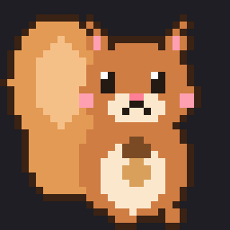
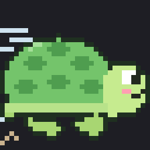
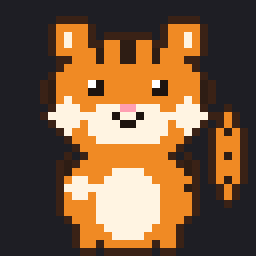
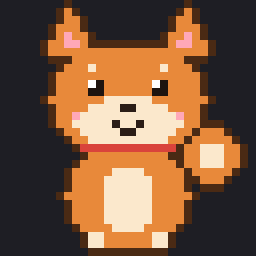
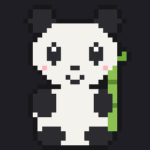
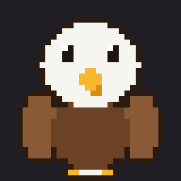
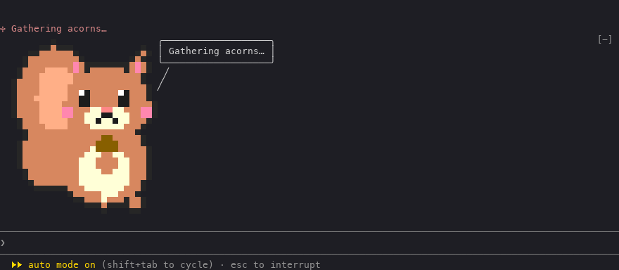
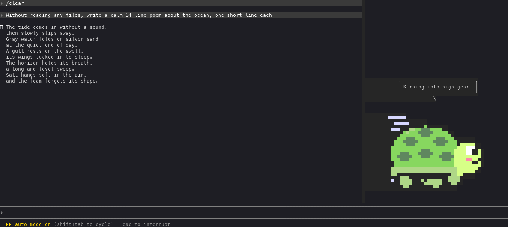
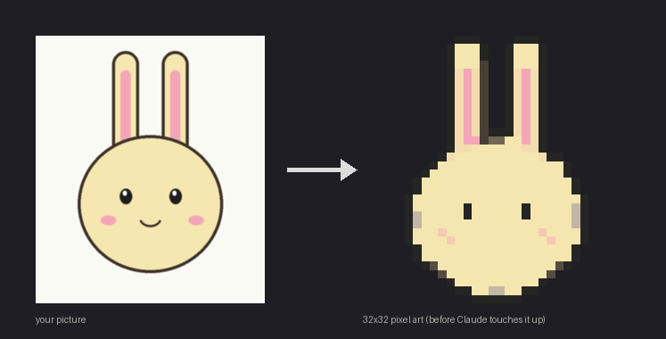

<div align="center">

 <br>
   

# dotchi

**把任何图片孵化成像素风宠物，让它陪在 Claude Code 旁边。**

[English](README.md) · [한국어](README.ko.md) · [日本語](README.ja.md) · **中文**

</div>

---

dotchi 是 [Claude Code](https://docs.claude.com/en/docs/claude-code) 的一个 mod。宠物住在终端里、对话旁边。Claude 工作时它会动起来，用漫画气泡说话，把加载提示换成自己的台词，还能在每次回答后补上一句。

<p align="center">
  
</p>

## 功能

- 🥚 **孵化自己的宠物。** 给它任何图片，图像处理会把它变成 32×32 像素画。接着 Claude 修饰细节，询问名字、性格和要动的部位，让这些部位动起来，并写好台词。你同意之前什么都不会保存。
- 🎞️ **真正的像素动画。** 不是整张图移动，而是你选的手臂、腿、耳朵、尾巴、车轮等部位在动。
- 💬 **会说话。** 漫画气泡、Claude 工作时的加载台词，以及回答后的一句话（可选）。
- 🪟 **输入框上方或侧边面板。** 可以把宠物放在右侧面板，回答使用其余的屏幕空间。
- 👀 **替你盯着。** 每周额度超过 80、85、90、95、99% 时提醒，较长的回答结束时发桌面通知，在你继续一个闲置超过一天的大对话之前先告诉你。侧边面板里始终显示 `git status` 和本次会话的 artifact。
- 📊 **电子宠物式仪表。** 状态栏用爱心 `♥♥♥♡♡ 62%` 显示上下文的占用，用 `⚡ 41%` 显示每周额度，还有分支、未提交的 `+/−` 行数和会话时长。到 70% 宠物会开始担心，到 90% 会建议 `/compact`。侧边面板用粉彩色显示同样的内容。
- 🎨 **状态栏主题。** 仪表的外观与宠物分开选择：粉彩（默认）、糖果、森林、只用 ASCII 的单色，以及没有宠物元素的现代、绿屏经典和彩虹。可以和 Claude 一起做自己的主题，用命令改一个颜色或表情，并在 [dotchi 网站](https://ms1011.github.io/dotchi-packs/?tab=themes)分享。
- 📦 **分享角色包。** 每个角色就是一个小角色包。一条命令就能发布到 [dotchi 宠物网站](https://ms1011.github.io/dotchi-packs)，也可以导出成 zip。
- 🌏 **台词支持四种语言。** 宠物可以用韩语、英语、日语或简体中文说话。命令提示为英语。
- 🌱 **一周里慢慢长大。** 每周额度用得越多，宠物就会长到 3 个阶段（33% 起第 2 阶段，66% 起第 3 阶段），额度重置时回到第 1 阶段，上周的宠物会留在相册里。没有每周额度的账号按和 Claude 一起工作的天数（2 天第 2 阶段，4 天第 3 阶段）或自己设定的美元预算成长。离开一天以上再回来时它会迎接你，按 ♥（宠物有焦点时按 `p`）可以摸摸它。每只内置宠物都有自己的第 2、3 阶段造型，新孵化的宠物也会在孵化时一起设计。
- 🐿️🐢 **一开始就有六只：** 抱着橡果的松鼠、其实跑得飞快的乌龟，以及每个国家一只：老虎 🐯（韩国）、柴犬 🐕（日本）、熊猫 🐼（中国）、白头海雕 🦅（美国）

<p align="center">
  
</p>

## 安装

在 Claude Code 中：

```
/plugin install dotchi --marketplace ms1011/dotchi
```

询问是否添加 marketplace 时输入 `y`，范围选择用户（user）。也可以在终端中：

```sh
claude plugin install dotchi --marketplace ms1011/dotchi
```

**需要**

- 支持 mod 的 Claude Code（v2.1.306 或更高）
- 孵化和 zip 角色包需要 Python 3。第一次孵化时会把 OpenCV、numpy、Pillow 安装到 `~/.claude/dotchi/venv`。
- 要在网站上分享宠物，需要已登录的 [GitHub CLI](https://cli.github.com)（`gh`）

**更新**

```sh
claude plugin marketplace update dotchi
claude plugin update dotchi
```

然后重启 Claude Code。你自己的角色保存在 `~/.claude/dotchi`，更新后也不会丢失。

## 命令

全部在 `/dotchi` 下。

| 命令 | 作用 |
| :- | :- |
| `/dotchi` | 查看当前设置 |
| `/dotchi <角色>` | 切换角色（id 或名字） |
| `/dotchi list` | 内置角色和我的角色列表 |
| `/dotchi hatch [图片路径]` | 用图片孵化新角色 |
| `/dotchi edit <角色>` | 和 Claude 一起修改角色 |
| `/dotchi install <zip、文件夹或网站 id>` | 安装角色包，或按 id 或链接安装网站上的宠物 |
| `/dotchi export <角色> [--with-source]` | 在当前文件夹保存为 `<id>.dotchi.zip` |
| `/dotchi share <角色> [--as <id>]` | 把宠物发布到 dotchi 网站（id 被占用时用 `--as` 先改名） |
| `/dotchi unshare <角色>` | 从网站撤下自己的宠物 |
| `/dotchi remove <角色>` | 删除我的角色 |
| `/dotchi show always\|working\|side` | 始终显示 / 仅在 Claude 工作时 / 侧边面板 |
| `/dotchi voice on\|off` | 回答后的一句话 |
| `/dotchi limit on\|off` | 每周额度 80、85、90、95、99% 提醒 |
| `/dotchi notify on\|off` | 回答耗时较长时发桌面通知 |
| `/dotchi notify after <秒>` | 多久算耗时较长（默认 60 秒） |
| `/dotchi notify fix` | 收不到通知时，把 Claude Code 的通知渠道改为 `iterm2_with_bell` |
| `/dotchi rest <小时> <token>\|off` | 离开这么久后，在不少于这么多 token 的对话里开始输入时提醒（默认 24 小时、100k） |
| `/dotchi line full\|mini\|off` | 状态栏显示什么：全部（默认）、只显示百分比和分支、不显示 |
| `/dotchi line cost on\|off` | 在状态栏和面板显示会话费用（$）（默认关闭：订阅用户实际支付的不是这个金额） |
| `/dotchi line context\|week <注意> <危险>\|reset` | 修改仪表变成黄色、珊瑚色的百分比（默认上下文 70/90，每周 80/95）。上下文的危险值也是宠物建议 `/compact` 的时机 |
| `/dotchi theme [list]` | 状态栏主题列表（内置和自己的） |
| `/dotchi theme <主题>` | 切换主题（id 或名字） |
| `/dotchi theme new [想法]` | 和 Claude 一起做主题：询问风格，写好 `theme.json`，检查并预览 |
| `/dotchi theme edit [主题]` | 和 Claude 一起修改主题（省略则为当前主题） |
| `/dotchi theme set <项> <值>` | 只改当前主题的一项：`color.ok #8fd9b6`、`face.danger (×_×)`、`hearts ♥ ♡`、`bar ▰ ▱`、`symbol.week ⚡` … |
| `/dotchi theme install <文件或网站 id>` | 安装 `theme.json` 文件，或网站上的主题（id 或链接） |
| `/dotchi theme export <主题>` | 在当前文件夹保存为 `<id>.theme.json` |
| `/dotchi theme share <主题> [--as <id>]` | 把主题分享到 dotchi 网站 |
| `/dotchi theme unshare <主题>` | 从网站撤下自己的主题 |
| `/dotchi theme remove <主题>` | 删除自己的主题 |
| `/dotchi grow` | 本周宠物的阶段，以及到下一阶段还差什么 |
| `/dotchi grow reset on\|off` | 每周重置时是否回到第 1 阶段（默认 on）；off 则保持达到过的最高阶段 |
| `/dotchi grow budget <美元>\|off` | 没有每周额度时：用每周美元预算代替工作天数来成长 |
| `/dotchi album` | 过去的每一周：宠物、达到的阶段、摸摸次数、最常工作的时段 |
| `/dotchi evolve <角色>` | 和 Claude 一起给宠物画第 2、3 阶段造型（饰品或衣服） |
| `/dotchi lang ko\|en\|ja\|zh\|auto` | 宠物台词和名字的语言（`auto` 跟随系统设置） |

**通知。** 等待你批准时，Claude Code 会自己发通知，宠物只在气泡里说一声。较长回答结束时的通知由 dotchi 发送。它们都是终端通知，需要你的终端应用显示出来。收不到的话，运行 `/dotchi notify fix`。

**git 与 artifact。** 在侧边面板里，宠物下方会显示分支、改动的文件（Claude 编辑过的带 ✎）和本次会话发布的 artifact。没有面板时，状态栏会显示一行摘要。

**状态栏。** `🌰 ♥♥♥♡♡ 62% · ⚡ 41% · ⎇ main ↑2 · 3 个文件 +120 −8 · 12分 · 🔗 报告`。爱心表示上下文占用：从 70% 起宠物 `(•_•;)` 开始担心，到 90% 会 `(×_×)` 并提醒一次 `/compact`。`⚡` 是每周额度，🥱 表示照这个速度会在重置前用完。为 0 或未知的值不显示。这些百分比可以用 `/dotchi line context` 和 `/dotchi line week` 修改。在侧边面板里，同样的数字变成粉彩色进度条，表情用宠物的代表色，最后一行显示会话时长、模型和上下文大小。

**主题。** 主题只包含外观：五种颜色（`ok`、`warn`、`danger`、`dim`、`accent`，accent 为 `pet` 时使用宠物的代表色）、三个表情、爱心和进度条字符、四个符号。百分比设置仍是你自己的。主题保存在 `~/.claude/dotchi/themes/<id>/theme.json`，没写的项用粉彩补上。修改内置主题会生成同 id 的个人副本，删除副本即恢复内置主题。可以用 `python3 tools/theme.py check <文件>` 检查，用 `python3 tools/theme.py preview <文件>` 带颜色预览。

**侧边面板。** `/dotchi show side` 会把宠物放到右侧面板（约占宽度 20%）。面板在全屏模式下会停靠在对话旁边，所以请先运行一次 `/tui fullscreen`。用 `Ctrl+X` 加方向键调整宽度，用 `Ctrl+X` 加 `X` 关闭。

## 孵化自己的宠物

```
/dotchi hatch ~/Pictures/my-cat.png
```

<p align="center">
  
</p>

Claude 会一次问一个问题，带你完成：

1. 把图片变成像素画，修好糊掉的地方（眼睛、嘴巴、轮廓）。
2. 询问名字和性格。
3. 建议可以动的部位（手臂、腿、耳朵、尾巴；如果是汽车，就是车轮和烟），让你选择。
4. 只让选中的部位以 3～5 帧动起来。
5. 写出符合性格的台词。
6. 展示预览图和动图 GIF，检查角色包，你同意后才保存。

以后要修改：`/dotchi edit <角色>`。

## 分享角色包

**在 dotchi 宠物网站上。** [ms1011.github.io/dotchi-packs](https://ms1011.github.io/dotchi-packs) 汇集了大家做的宠物。每只宠物都有复制安装命令的按钮。

```
/dotchi share my-cat               # 用 gh 在 ms1011/dotchi-packs 上创建 Issue
/dotchi install my-cat             # 任何人都能按 id（或宠物页面链接）安装
/dotchi unshare my-cat             # 撤下
```

分享需要已登录 GitHub 的 `gh`。Issue 上会运行检查，通过后一两分钟内就会出现在网站上。点赞就是在 GitHub 上该宠物的 Issue 点 👍，所以需要 GitHub 账号；网站上的数字大约一分钟内就会更新。

**作为文件。**

```
/dotchi export my-cat              # → ./my-cat.dotchi.zip
/dotchi install ~/Downloads/my-cat.dotchi.zip
```

角色包是一个文件夹（或它的 zip）：

```
<角色包>/
  dotchi.json   { "format": 1, "id", "name", "author"?, "description"?, "frameMs"?, "icon"? }
  art.json      { "width": 32, "height": 32, "idle": Frame, "work": [Frame, …] }   （1～5 帧）
  lines.json    { "<语言>": { "spinner": [...], "idle": [...], "ending": [...] }, … }
  grid/         （可选）可编辑的文本网格
  source/       （可选）原始图片
```

- `id`：小写字母、数字和 `-`，最多 32 个字符。如果已被占用，安装时会加上 `-2`、`-3`……
- `name`：一个字符串，或按语言分别命名：`{ "zh": "松鼠", "en": "Squirrel" }`
- `frameMs`：每帧时长，60～1000 毫秒（默认 250）
- `icon`：状态栏最前面的一个表情符号（松鼠是 🌰）。没有则为 🐾
- `lines.json`：`ko`、`en`、`ja`、`zh` 任意几种。缺少的语言先用英语，再用角色包里的第一种语言。
- `Frame` 是 32 行 × 32 格，每格是 `"rrggbb"` 或透明（`null`）。
- 安装和导出时只复制上面这些文件，并跳过符号链接。不加 `--with-source` 时不会导出 `source/`。

> [!NOTE]
> **请尊重作者。** 如果你用别人的作品孵化角色，请只在个人范围内使用，不要公开分享角色包。

## 文件位置

| 路径 | 内容 |
| :- | :- |
| `~/.claude/dotchi/characters/` | 孵化或安装的角色 |
| `~/.claude/dotchi/themes/` | 自己做的、改过的或安装的状态栏主题 |
| `~/.claude/dotchi/drafts/` | 正在孵化或修改的角色 |
| `~/.claude/dotchi/venv/` | 图像处理工具 |

## dotchi 会发送和获取什么

dotchi 本身没有任何统计或遥测。显示宠物、切换、修改、导出，以及从 zip 或文件夹安装，都只在你的电脑上进行。只有下面这些命令会联网：

| 什么时候 | 做什么 |
| :- | :- |
| 第一次 `/dotchi hatch` | `tools/setup.sh` 创建 `~/.claude/dotchi/venv`，并从 PyPI 安装 numpy、opencv-python-headless、pillow，版本固定在 `tools/requirements.lock` 中。图片在你的电脑上处理。图片和预览会像你在对话中给 Claude 看的其他文件一样由 Claude 读取。 |
| `/dotchi install <id 或链接>` | 从 `https://ms1011.github.io/dotchi-packs/packs/<id>/` 下载该宠物的 `dotchi.json`、`art.json`、`lines.json`。除了这些下载请求之外，不会发送任何关于你或你的宠物的信息。 |
| `/dotchi share <角色>` | 读取 `https://ms1011.github.io/dotchi-packs/index.json` 来检查 id 是否已被占用，并运行 `gh auth status` 和 `gh api user` 获取你的 GitHub 用户 id。然后用 `gh issue create` 以你的 GitHub 账号在 [ms1011/dotchi-packs](https://github.com/ms1011/dotchi-packs) 上创建一个**公开** Issue。Issue 中包含宠物的名字和简介，以及角色包（`dotchi.json`、`art.json`、`lines.json`、`grid/*.txt`，gzip 压缩）。原始图片（`source/`）不会发送。发布后，网站上会显示宠物和你的 GitHub 用户名。 |
| `/dotchi unshare <角色>` | 运行 `gh auth status`，然后在 ms1011/dotchi-packs 上创建一个公开 Issue，请求撤下该宠物。 |
| `/dotchi theme install <id 或链接>` | 从 `https://ms1011.github.io/dotchi-packs/themes/<id>/` 下载该主题的 `theme.json`，不会发送其他内容。 |
| `/dotchi theme share <主题>` / `theme unshare` | 与分享宠物相同：用 `index.json` 检查 id，运行 `gh auth status` 和 `gh api user`，然后创建包含主题 `theme.json` 的**公开** Issue（`theme-share:` 或 `theme-unshare:`）。 |

dotchi 不会直接读取你的 GitHub 令牌，`gh` 使用你通过 `gh auth login` 设置的登录。分享的宠物是公开的：请只分享用你自己画的、拍的或有权分享的图片做成的宠物。

每周额度提醒、通知和闲置对话提醒只使用 Claude Code 已经提供给 mod 的数字，不会发送到任何地方。为了填充侧边面板和状态栏，dotchi 会在项目文件夹里每 30 秒以及编辑之后运行 `git status` 和 `git diff --numstat`（只读），并把本次会话发布的 artifact 的标题和链接记在 mod 的存储里。

[dotchi 宠物网站](https://ms1011.github.io/dotchi-packs)在浏览器中运行。它从 GitHub Pages 加载宠物，并向 `api.github.com` 查询每只宠物的 👍 数。

## 开发

```sh
claude --plugin-dir .                     # 把这个文件夹作为 mod 启动 Claude Code
claude plugin validate .
claude plugin test .
sh tools/setup.sh                         # 创建 ~/.claude/dotchi/venv
~/.claude/dotchi/venv/bin/python -m unittest discover -s tools -p "test_*.py"
~/.claude/dotchi/venv/bin/python tools/defaults/build.py   # 重新生成内置角色
```

`tsconfig.json` 继承 `.claude-plugin/types/`。这个文件夹会在 Claude Code 第一次从此文件夹加载 mod 时（`claude --plugin-dir .`）生成。之后就可以用 `tsc -p .` 做类型检查。

## 许可证

[MIT](LICENSE)
